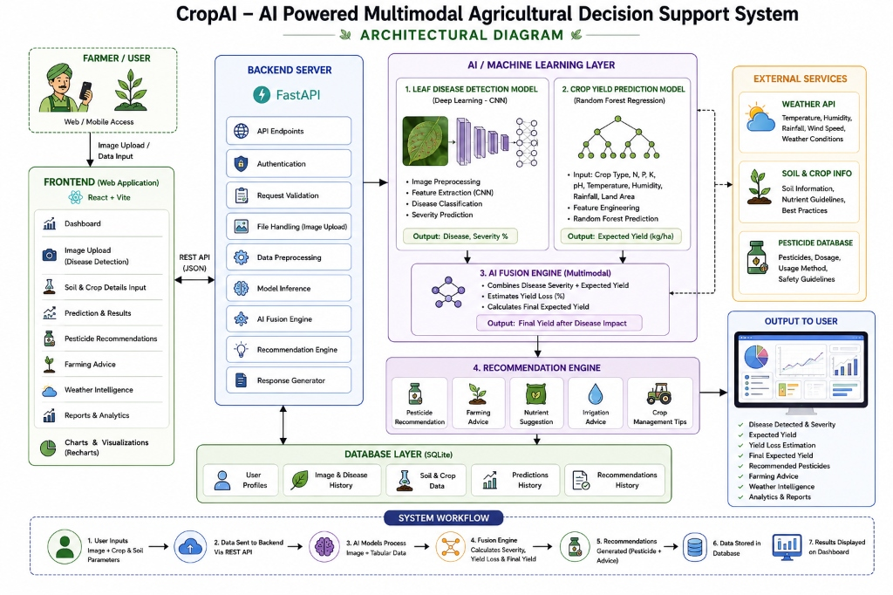
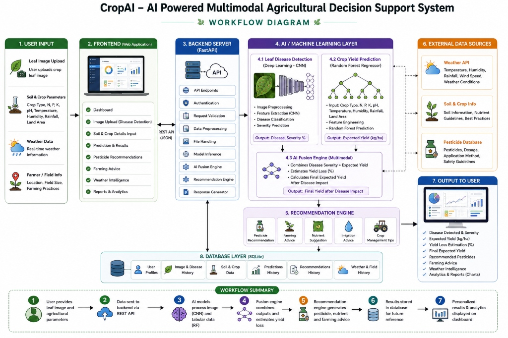

# 🌱 AgriShield – AI-Powered Multimodal Agricultural Decision Support System

<p align="center">
An intelligent agricultural platform that combines Computer Vision, Machine Learning, and AI to detect crop diseases, predict crop yield, estimate yield loss, and provide personalized farming recommendations.
</p>

---

## 📖 Overview

**AgriShield** is an AI-powered multimodal agricultural decision support system designed to assist farmers in making informed decisions through intelligent crop analysis. The platform integrates a **Convolutional Neural Network (CNN)** for crop disease detection and a **Random Forest Regression** model for crop yield prediction. A custom **AI Fusion Engine** combines the outputs of both models to estimate disease severity, predict yield loss, calculate the final expected yield, and recommend suitable pesticides and farming practices.

---

## ✨ Features

* 🌿 **AI-Powered Crop Disease Detection:** Identifies crop infections from leaf images.
* 📷 **Leaf Image Upload:** Easy drag-and-drop classification interface.
* 🌾 **Crop Yield Prediction:** Predicts crop output based on environmental and soil variables.
* 🧪 **Soil Parameter Analysis:** Analyzes soil composition for better crop management.
* 🔀 **Multimodal AI Fusion Engine:** Fuses data from image and tabular inputs.
* 📉 **Disease Severity & Yield Loss Estimation:** Approximates impact of diseases on the total crop yield.
* 💊 **Intelligent Pesticide Recommendation:** Recommends optimal chemical/organic treatments.
* 🌱 **Personalized Farming Advice:** Offers tailored operational guides and guidance.
* 🌦 **Weather Intelligence Panel:** Provides real-time atmospheric readings.
* 📊 **Interactive Dashboard & Analytics:** Detailed visual feedback via interactive charts.
* 📱 **Fully Responsive Web Interface:** Seamlessly runs on desktop, tablet, and mobile.

---

## 🏗️ System Architecture

The system architecture of AgriShield is illustrated below:

<p align="center">
  
</p>

---

## 🔄 Workflow

The complete workflow of AgriShield is illustrated below:

<p align="center">
  
</p>

---

## 🤖 AI Models

### 🌿 Disease Detection
* **Model:** Convolutional Neural Network (CNN)
* **Input:** Crop Leaf Image
* **Output:**
  * Disease Name
  * Confidence Score
  * Disease Severity

### 🌾 Crop Yield Prediction
* **Model:** Random Forest Regressor
* **Input Features:**
  * Crop Type
  * Nitrogen (N)
  * Phosphorus (P)
  * Potassium (K)
  * Soil pH
  * Temperature
  * Humidity
  * Rainfall
  * Land Area
* **Output:**
  * Expected Crop Yield

### 🔀 AI Fusion Engine
Combines predictions from both AI models to generate:
* Disease Severity (%)
* Estimated Yield Loss (%)
* Final Crop Yield after disease impact
* Targeted Pesticide Recommendations
* Personalized Farming Advice

---

## 🛠️ Tech Stack

### Frontend
* **React.js** (Vite template)
* **Tailwind CSS** for custom interfaces
* **Axios** for API requests
* **Recharts** for visualizations
* **React Icons** for iconography

### Backend
* **FastAPI** for high-performance REST APIs
* **Python**
* **Uvicorn** as the ASGI server

### Machine Learning
* **TensorFlow / Keras** for Deep Learning
* **Scikit-learn** for Random Forest regression
* **OpenCV** & **PIL** for image preprocessing
* **Pandas** & **NumPy** for data structures

### Database
* **SQLite** (via SQLAlchemy)

---

## 📂 Project Structure

```text
AgriShield/ (CropAI)
│
├── backend/                   # FastAPI Backend Server
│   ├── app.py                 # Main Application Entrypoint
│   └── requirements.txt       # Python Backend Dependencies
│
├── frontend/                  # React + Vite Frontend App
│   ├── src/                   # Components, Styles, and Assets
│   ├── package.json           # Node Dependencies & Scripts
│   └── vite.config.js         # Vite Configuration
│
├── models/                    # Pre-trained ML/DL Model Files
│   ├── plant_disease_model.h5 # CNN Model for Disease Detection
│   ├── yield_model.pkl        # Random Forest Regressor for Yield
│   └── crop_encoder.pkl       # Label Encoder for Crop Types
│
├── data/                      # Database & Configuration Files
│   ├── class_names.json       # Mapping of Disease Class Indices to Names
│   ├── loss_table.json        # Estimated Crop Yield Loss Percentage
│   └── pesticide.json         # Recommended Pesticides & Treatment Guidelines
│
├── docs/                      # Documentation Assets
│   ├── architecture.png       # System Architecture Diagram
│   └── workflow.png           # System Workflow Diagram
│
└── README.md                  # Project Documentation
```

---

## 🚀 Installation & Setup

### 1. Clone Repository
```bash
git clone https://github.com/your-username/AgriShield.git
cd AgriShield
```

### 2. Backend Setup
Navigate to the `backend` folder, create a virtual environment, install the dependencies, and start the FastAPI server:
```bash
cd backend
python -m venv venv
# Activate virtual environment
# On Windows:
venv\Scripts\activate
# On macOS/Linux:
source venv/bin/activate

pip install -r requirements.txt
uvicorn app:app --reload
```

### 3. Frontend Setup
Open a new terminal window, navigate to the `frontend` folder, install the dependencies, and run the development server:
```bash
cd frontend
npm install
npm run dev
```

---

## 📊 Outputs & Analytics

The dashboard provides comprehensive metrics including:
* 🌿 **Crop Disease Detection:** Fast classification and visual representation of crop health.
* 📉 **Disease Severity Analysis:** Shows active disease propagation percentages.
* 🌾 **Crop Yield Prediction:** Base expected yield calculation before external impacts.
* 📊 **Yield Loss Estimation:** Dynamic calculation showing loss from health complications.
* 💊 **Pesticide Recommendations:** Chemical name, dose, treatment cycle, and precaution measures.
* 🌦 **Weather Intelligence:** Temperature, precipitation levels, and crop safety thresholds.
* 🌱 **Personalized Farming Advice:** Irrigation and fertilizer optimization tips.
* 📈 **Interactive Visual Analytics:** Graphs detailing soil health vs. predicted performance.

---

## 👩‍💻 Author

**Poulami Kundu**
* B.Tech Computer Science & Engineering
* AI • Machine Learning • Full-Stack Development
